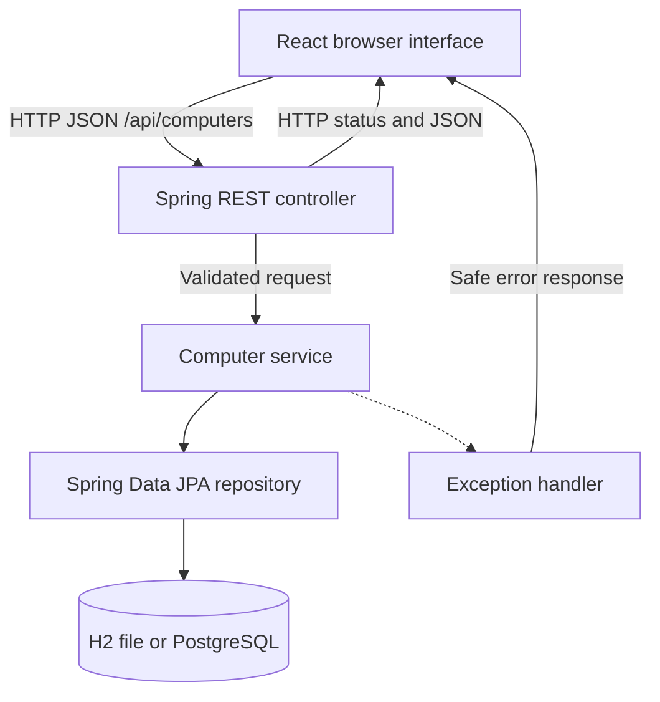

# System architecture

The packaged Spring Boot JAR also serves the compiled React files. In development, Vite serves the UI and proxies API calls to Spring. The browser only uses the REST API; it cannot access database files directly.

## Responsibilities

| Component | Responsibility |
| --- | --- |
| React pages and components | Present records, capture input, display loading/error states, and request pages |
| HTTP client | Serialize writable fields, call REST routes, and turn failures into `ApiError` objects |
| Controller | Map HTTP methods/paths and validate the request DTO using `@Valid` |
| Service | Apply assignment and uniqueness rules, transactions, search specifications, sorting, and summaries |
| Repository | Execute JPA queries and pagination against the database |
| Entity and migration | Define persistent fields, UUID identity, decimal cost, and unique constraints |
| Exception handler | Map known failures to 400/404/409 and hide internal exception details from 500 responses |

## Example: adding a computer

1. The form checks basic input and sends `POST /api/computers`.
2. Jackson builds a `ComputerRequest`. Its constructor trims text and normalizes identifiers.
3. Bean Validation checks required fields, formats, lengths, date, and cost.
4. The service checks the assignment rule and existing identifiers inside a transaction.
5. JPA generates a UUID and saves the entity. Unique database constraints provide a second layer of protection.
6. The controller returns 201, the record, and a Location header. React refreshes the list and full-inventory summary.

## Data lifetime and concurrency

The local database is a file under `backend/data`, separate from the React page and Java process memory. A restart reopens the same database when launched from the same working directory. The PostgreSQL profile moves storage to an external service. No HTTP session stores inventory records.

Two simultaneous writes using the same tag/serial cannot both succeed because of the database constraints. Updates use full replacement with last-write-wins behavior for separate editing sessions; optimistic client version checks are outside this course scope. H2 file mode supports the local single-instance demo. Multiple server instances require a shared PostgreSQL database and deployment routing.

The fictional data initializer records a completion marker so intentional deletions remain deleted. Disable it with `SEED_DEMO=false` for an empty inventory or when running multiple app instances.
